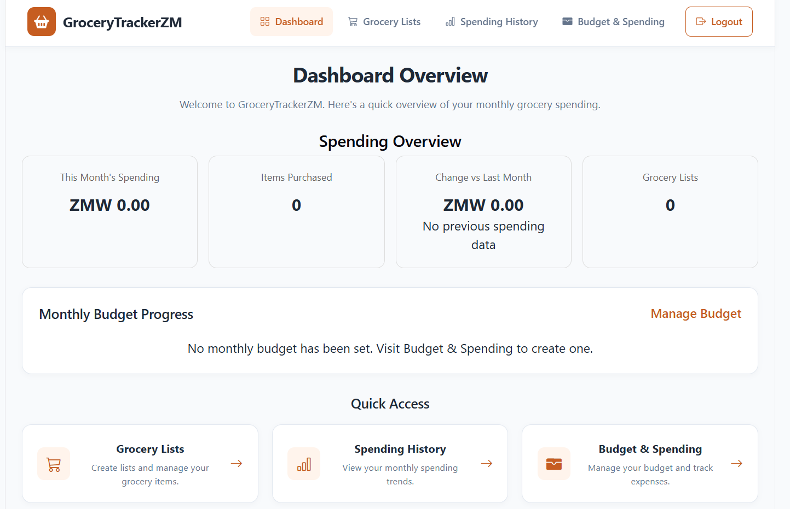
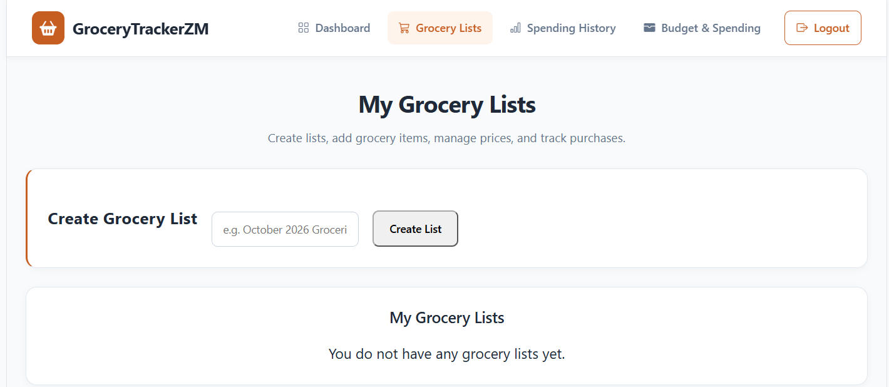
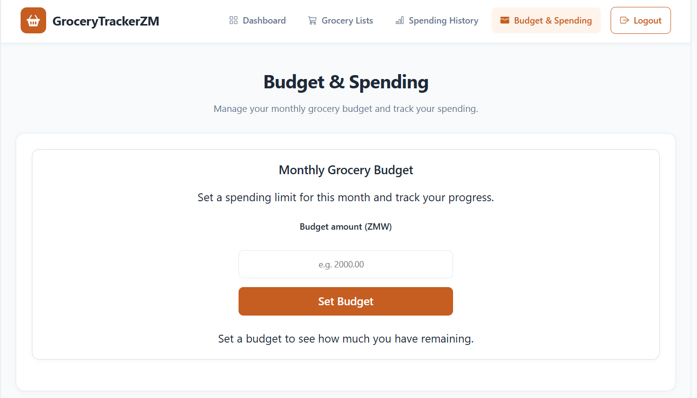

# GroceryTrackerZM

### Full-Stack Grocery Expense Tracking Application

GroceryTrackerZM is a full-stack web application designed to help users manage grocery shopping, track expenses, set monthly budgets, and monitor spending habits over time.

Built with **React, Django REST Framework, and PostgreSQL**, the application provides an organized platform for managing grocery expenses and understanding monthly spending patterns.

## Live Application

**Live Demo:** https://grocery-trackerzm.vercel.app

**Backend API:** https://grocery-trackerzm.onrender.com

## Key Features

### User Authentication
- User registration and login
- JWT-based authentication
- Google OAuth integration
- Protected routes for authenticated users

### Grocery Management
- Create and manage grocery lists
- Add grocery items with quantities and prices
- Mark items as purchased
- Edit and manage grocery items

### Expense Tracking
- Track grocery spending
- View monthly spending summaries
- Compare current and previous months
- Review historical spending

### Budget Management
- Set monthly grocery budgets
- Track spending against budgets
- View monthly budget history

### Dashboard
- Centralized overview of grocery expenses
- Spending summaries and monthly comparisons
- Grocery list management

## Technology Stack

| Layer | Technologies |
|---|---|
| Frontend | React, JavaScript, Vite, CSS |
| Backend | Python, Django, Django REST Framework |
| Database | PostgreSQL |
| Authentication | JWT, Google OAuth |
| API | REST |
| Frontend Hosting | Vercel |
| Backend Hosting | Render |
| Version Control | Git, GitHub |

## Project Architecture

```text
React Frontend (Vercel)
         |
         | REST API Requests
         |
         v
Django REST Framework (Render)
         |
         | Django ORM
         |
         v
PostgreSQL Database (Render)
```

## Screenshots

Add screenshots of the application here:

- Login page
- Registration page
- Main dashboard
- Grocery lists
- Monthly spending comparison
- Budget management

## Running the Project Locally

### Prerequisites

- Python
- Node.js and npm
- Git

### Clone the Repository

```bash
git clone https://github.com/chifatso/grocery-trackerzm.git
cd grocery-trackerzm
```

### Backend Setup

```bash
cd backend

python -m venv venv
```

Activate the virtual environment on Windows:

```bash
venv\Scripts\activate
```

Install dependencies:

```bash
pip install -r requirements.txt
```

Configure the required environment variables, including `DJANGO_SECRET_KEY`, database settings, and authentication credentials.

Run migrations:

```bash
python manage.py migrate
```

Start the backend:

```bash
python manage.py runserver
```

### Frontend Setup

Open another terminal and navigate to the frontend directory:

```bash
cd frontend
npm install
npm run dev
```

Configure the frontend API URL for your local Django backend.

## Future Improvements

- Complete password-reset email delivery
- Improve reporting and spending visualizations
- Expand grocery budgeting insights
- Add automated testing

## Author

Developed as a full-stack portfolio project to demonstrate practical experience with frontend development, backend APIs, authentication, databases, and cloud deployment.

## Screenshots

### Dashboard


### Grocery Lists


### Monthly Budget


### Monthly Budget
